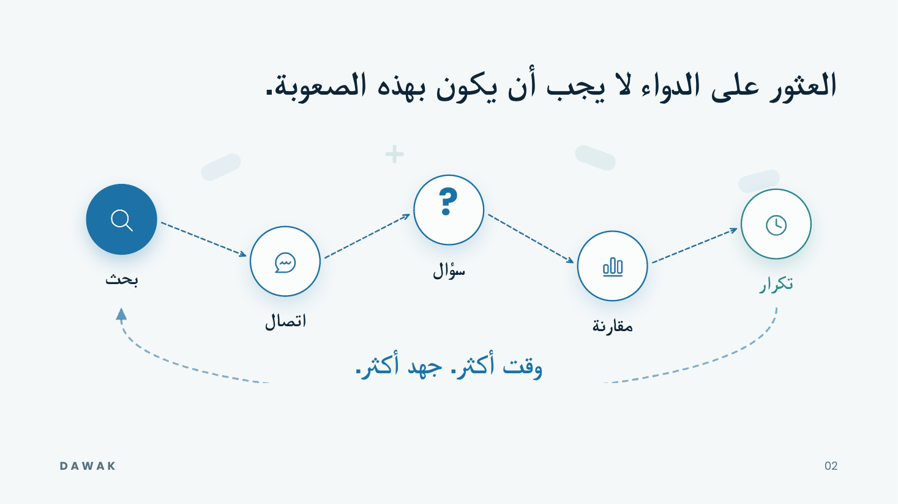
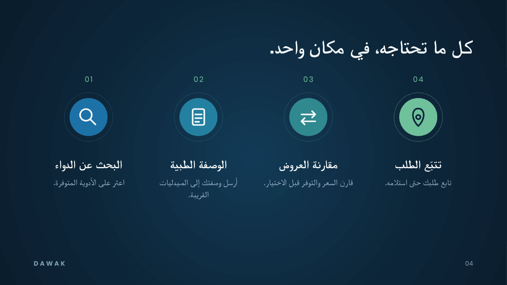
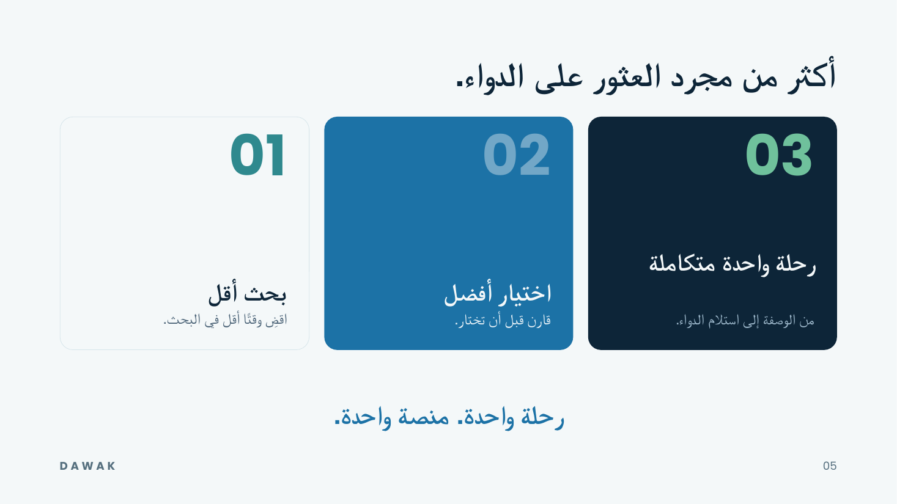
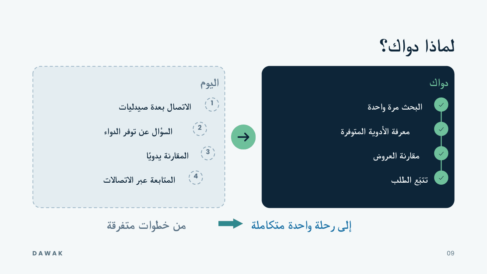
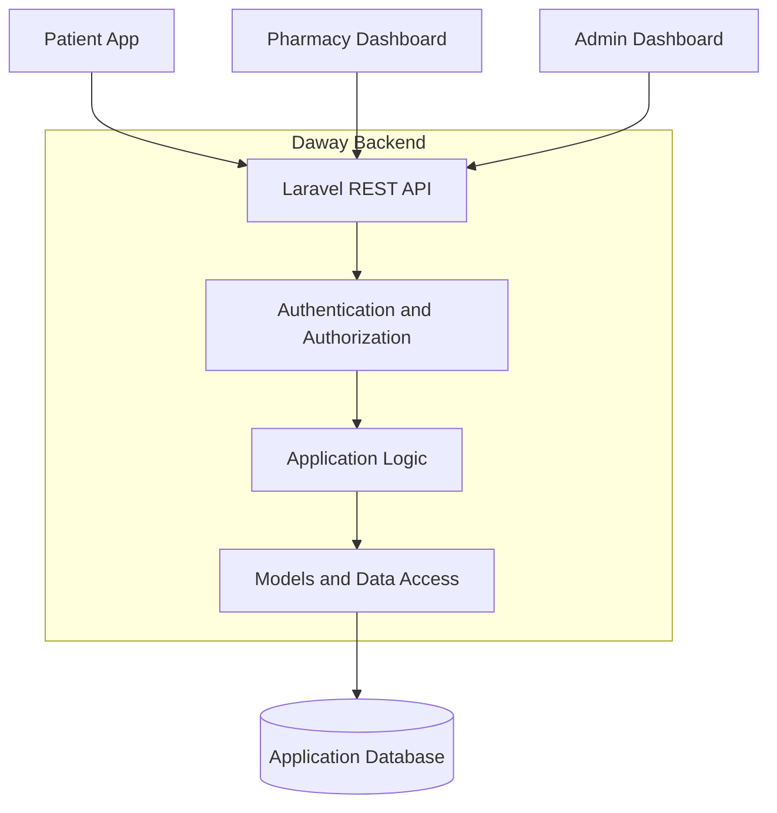

<div align="center">



# DAWAY | دواك

### Healthcare, in one place.

**Making medicine discovery easier by connecting patients with pharmacies.**

A Laravel-powered REST API for the Daway healthcare platform.

[](https://laravel.com/)
[](https://www.php.net/)
[](https://www.docker.com/)
[](https://render.com/)
[](https://github.com/daway-app/daway-backend/actions)

[Overview](#overview) · [Features](#key-features) · [Architecture](#architecture) · [Setup](#getting-started) · [API](#api-reference) · [Testing](#testing) · [Deployment](#deployment)

</div>

---


## Overview

Finding a medicine can involve calling multiple pharmacies, checking availability manually, and comparing prices across different sources.

**Daway (دواك)** aims to simplify this experience through a unified digital platform that connects patients and pharmacies.

This repository contains the backend service responsible for API communication, application logic, data access, and the server-side workflows used by the platform.

Our product vision:

**Discover → Compare → Request → Track**

Built with Laravel, the backend provides the foundation for a connected medicine-access experience.

## The Product

### The challenge



Patients can face fragmented information, repeated pharmacy calls, and limited visibility into medicine availability.

### The solution


Daway brings the patient and pharmacy journey into a unified platform, with the goal of making medicine discovery and coordination simpler.

### Core product capabilities



### Two sides, one platform


### Why Daway?

<table>
<tr>
<td width="50%" align="center">

**Platform Benefits**



</td>
<td width="50%" align="center">

**A Simpler Journey**



</td>
</tr>
</table>

*Product concept visuals illustrate the intended experience; individual capabilities depend on the current implementation.*

## Key Features

### Patient experience

- Medicine search and discovery.
- Medicine availability workflows.
- Prescription-related requests, where implemented.
- Pharmacy offer comparison workflows.
- Order management and tracking workflows.
- An AI assistant endpoint for medicine-related conversations.

### Pharmacy operations

- Medicine and inventory management.
- Patient request workflows.
- Pharmacy offers and availability information.
- Order-related operations.

### Platform capabilities

- API authentication and access control.
- Role-based permissions for protected operations.
- Database migrations and seeders.
- Automated testing infrastructure.
- Containerized deployment configuration.
- Continuous integration with GitHub Actions.

> The list describes project capabilities and intended workflows. Consult the registered routes and current implementation to verify the exact functionality available in a particular deployment.

## Architecture

Daway uses a client-server architecture: client applications communicate with the backend through HTTP APIs, while the backend manages business logic and database access.



### Request lifecycle

1. The client sends an HTTP request.
2. Laravel middleware processes the request and applies configured access controls.
3. Controllers and application services execute the relevant logic.
4. Models and database operations retrieve or update data.
5. The backend returns an HTTP response.

The database is accessed by the backend, not directly by the mobile application.

## Technology Stack

| Layer | Technology |
|---|---|
| Backend framework | Laravel 13 |
| Language | PHP 8.3+ |
| API | REST |
| Authentication | Laravel Sanctum, where configured |
| Data access | Eloquent ORM |
| Database | MySQL / PostgreSQL, depending on environment |
| Dependency management | Composer |
| Testing | PHPUnit and Laravel testing tools |
| CI/CD | GitHub Actions |
| Containerization | Docker |
| Hosting configuration | Render |

## Getting Started

### Prerequisites

- PHP 8.3 or later, with the extensions required by the project.
- Composer.
- A supported database server.
- Git.
- Node.js and npm if required by the project's asset build.

### 1. Clone the repository

```bash
git clone https://github.com/daway-app/daway-backend.git
cd daway-backend
```

### 2. Install dependencies

```bash
composer install
```

If the application requires npm dependencies:

```bash
npm install
```

### 3. Configure the environment

On Windows CMD:

```cmd
copy .env.example .env
```

On Linux or macOS:

```bash
cp .env.example .env
```

Generate the application key:

```bash
php artisan key:generate
```

Update `.env` with the credentials for your local database and any required external services.

### 4. Prepare the database

Create the configured database, verify the connection settings, and run:

```bash
php artisan migrate
```

If you need development seed data, review the project's seeders before running:

```bash
php artisan db:seed
```

Do not run development seeders against production data.

### 5. Start the application

```bash
php artisan serve
```

The default local address is:

`http://127.0.0.1:8000`

Inspect the registered API routes:

```bash
php artisan route:list --path=api
```

## Environment Configuration

Use `.env.example` as the reference for required configuration.

| Variable group | Purpose |
|---|---|
| `APP_*` | Application environment and URL |
| `DB_*` | Database connection |
| `CACHE_*` | Cache configuration |
| `SESSION_*` | Session configuration |
| `MAIL_*` | Email delivery |
| OTP / SMS settings | One-time-code delivery, if configured |
| AI service settings | Assistant integration, if configured |

### Security essentials

- Never commit `.env` or production credentials.
- Keep debug mode disabled in production.
- Store secrets in the hosting provider's environment settings.
- Protect sensitive endpoints with authentication and authorization.
- Validate incoming data on the server.
- Rotate any secret that has been exposed.

## API Reference

### Base URLs

Local development:

```text
http://127.0.0.1:8000/api
```

Configured production service:

```text
https://daway-backend.onrender.com/api
```

Production availability depends on the deployed service and its current health.

### API areas

| Domain | Responsibility |
|---|---|
| Authentication | Login and OTP-related workflows |
| Patient | Patient-facing operations |
| Medicines | Medicine search and management |
| Pharmacy | Pharmacy operations and offers |
| Orders | Order-related workflows |
| Administration | Protected management operations |

### Example: Assistant API

A known endpoint in the project is:

```http
POST /api/patient/assistant/chat
Content-Type: application/json
Authorization: Bearer YOUR_TOKEN
```

Example request:

```json
{
  "message": "Do you have paracetamol 500mg?"
}
```

Example cURL command:

```bash
curl -X POST "http://127.0.0.1:8000/api/patient/assistant/chat" \
  -H "Authorization: Bearer YOUR_TOKEN" \
  -H "Content-Type: application/json" \
  -d '{"message":"Do you have paracetamol 500mg?"}'
```

Replace `YOUR_TOKEN` with a valid token from the configured authentication flow.

### Discover all registered endpoints

```bash
php artisan route:list --path=api
```

Check the [`postman/`](./postman/) directory for available API testing resources.

For complete API documentation, each endpoint should specify its HTTP method, authentication requirements, request parameters, response schema, and possible error codes.

## Testing

Run the automated test suite:

```bash
php artisan test
```

Alternatively:

```bash
vendor/bin/phpunit
```

On Windows CMD:

```cmd
vendor\bin\phpunit
```

### Quality assurance

The repository includes test areas for application features and other backend concerns. Relevant tests should be executed when changing:

- API behavior and validation.
- Authentication and permissions.
- Medicine management.
- Administrative workflows.
- Database interactions.
- Security-sensitive operations.

### Continuous integration

The GitHub Actions workflow is located at:

[`.github/workflows/laravel.yml`](./.github/workflows/laravel.yml)

Review the workflow configuration and its latest run to confirm which checks execute for each push and pull request.

[**View CI runs →**](https://github.com/daway-app/daway-backend/actions)

No test coverage percentage or passing status is claimed here; those should be reported from verified test results.

## Deployment

The repository includes a `Dockerfile` and a `render.yaml` configuration.

### Deployment workflow

1. Push the approved changes to the intended branch.
2. Review CI results and test failures.
3. Configure the service environment variables.
4. Verify database connectivity and credentials.
5. Deploy using the repository's actual hosting configuration.
6. Apply migrations through the approved deployment process.
7. Verify service health, logs, and critical API workflows.

### Production checklist

- [ ] Environment variables are configured securely.
- [ ] Database connectivity is verified.
- [ ] Migrations have been reviewed.
- [ ] Debug mode is disabled.
- [ ] Authentication and permissions are verified.
- [ ] Health checks succeed.
- [ ] Critical API workflows are smoke-tested.

Review [`Dockerfile`](./Dockerfile) and [`render.yaml`](./render.yaml) before deploying. The start command, port, health-check path, and migration strategy must match the actual configuration.

## Contributing

Contributions should improve functionality, security, maintainability, or developer experience.

1. Create a feature branch from the team's target branch.
2. Follow the project's coding conventions.
3. Add or update relevant tests.
4. Run the applicable checks locally.
5. Open a pull request with a clear explanation of the change.
6. Request review before merging.

Example workflow:

```bash
git checkout develop
git pull origin develop
git checkout -b feature/your-feature
```

After making and testing your changes:

```bash
git add .
git commit -m "feat: describe your change"
git push -u origin feature/your-feature
```

Use clear, focused commit messages. The team may follow [Conventional Commits](https://www.conventionalcommits.org/), including prefixes such as `feat:`, `fix:`, `test:`, and `docs:`.

## Roadmap

The following are product and engineering goals, not claims of completed functionality.

- [ ] Validate core workflows with patients and pharmacies.
- [ ] Expand API documentation.
- [ ] Improve automated test reliability and coverage.
- [ ] Strengthen deployment monitoring.
- [ ] Prepare for a broader pilot.

## Team

Daway is a collaborative healthcare technology project focused on making medicine discovery and pharmacy coordination easier.

[**Explore contributors →**](https://github.com/daway-app/daway-backend/graphs/contributors)

## License

**Proprietary — All rights reserved.**

Copyright © Daway.

No permission to redistribute, modify, or commercially use this software is granted unless explicitly authorized by the rights holder.

---

<div align="center">

### DAWAY | دواك

**Healthcare, in one place.**

*Making medicine discovery easier.*

[Repository](https://github.com/daway-app/daway-backend) · [Issues](https://github.com/daway-app/daway-backend/issues) · [CI Workflows](https://github.com/daway-app/daway-backend/actions)

</div>
