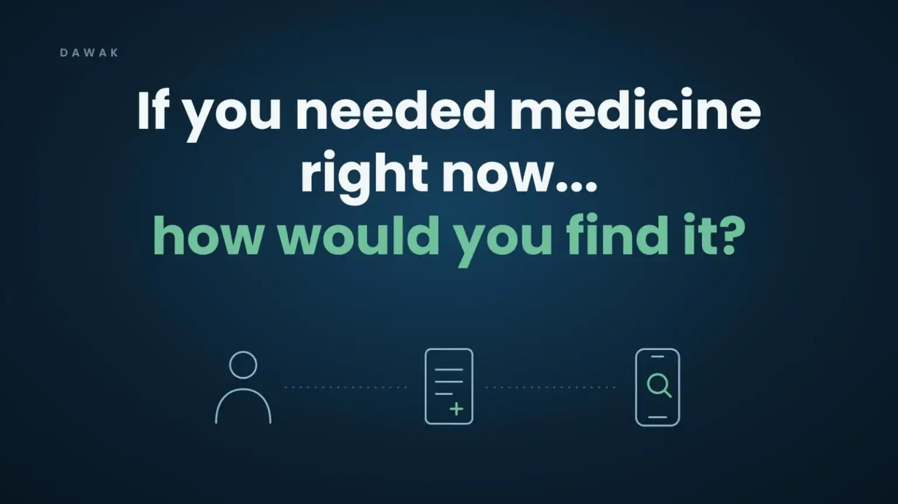
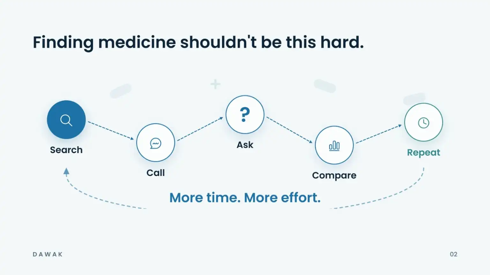
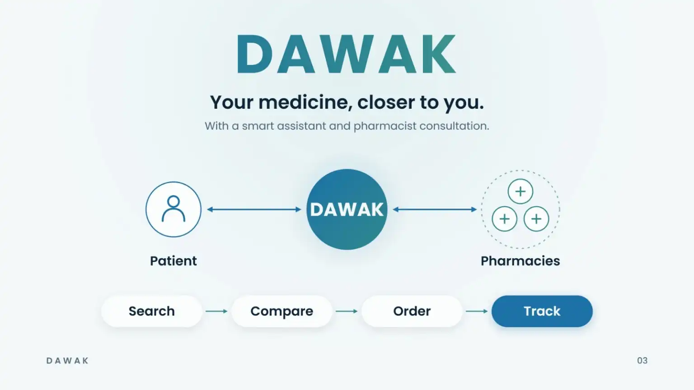
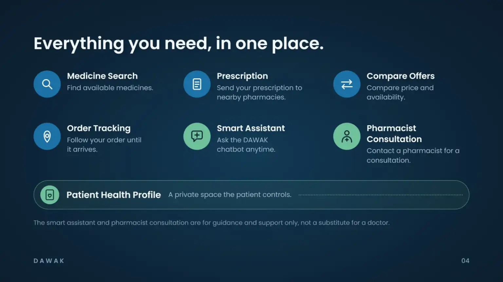
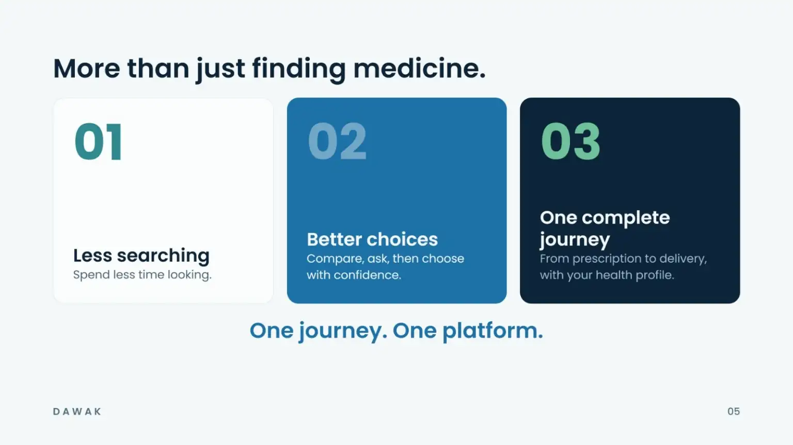
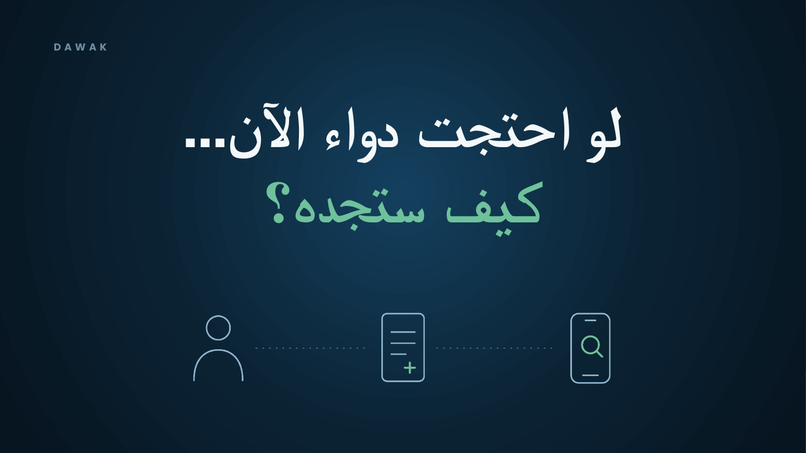
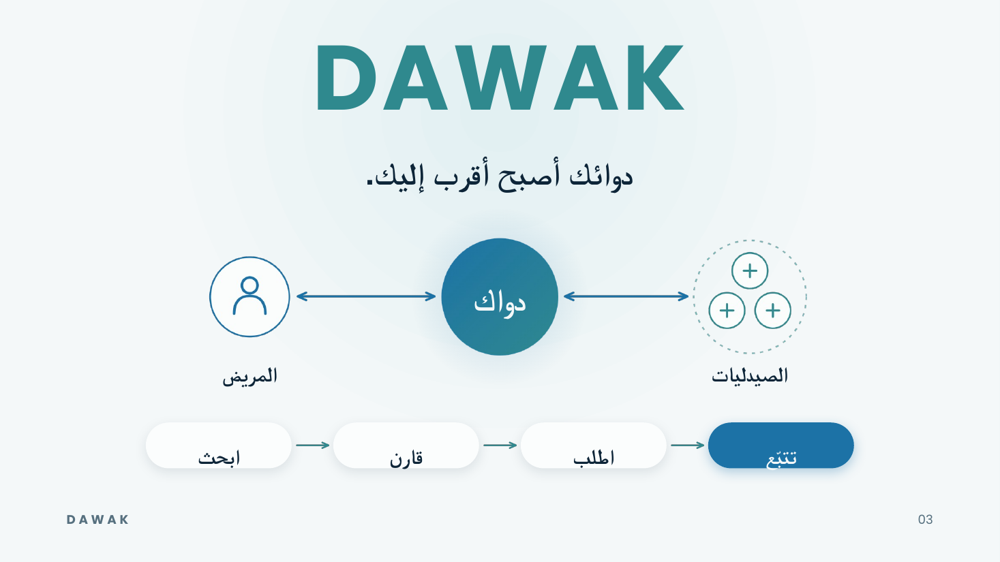
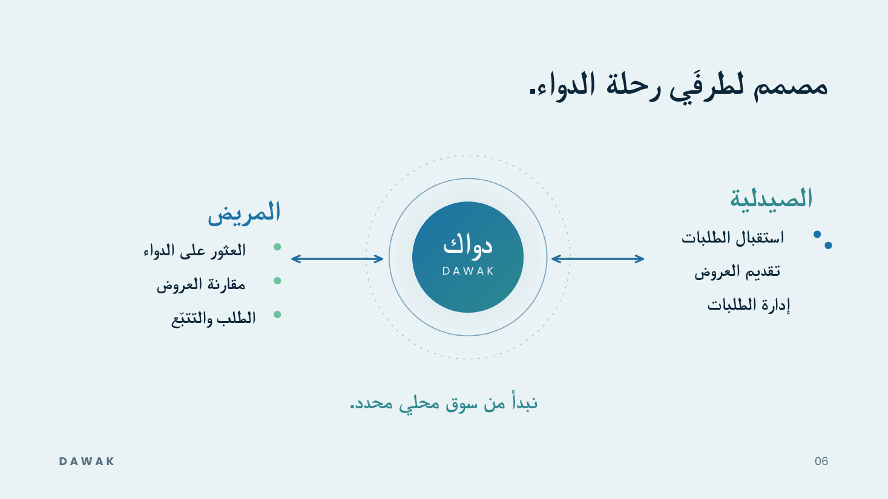
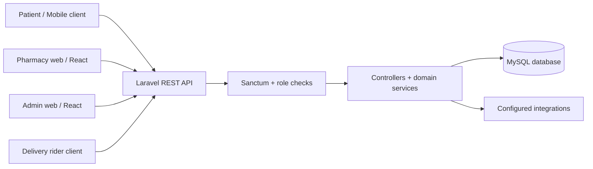
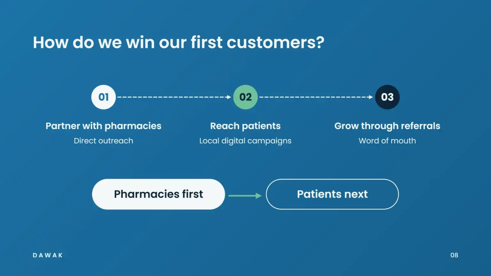

<div align="center">


# DAWAK | دوّاك

### Your medicine, closer to you.

*Healthcare, in one place.*

**A connected pharmacy experience, powered by a Laravel REST API.**

[](https://laravel.com/)
[](https://www.php.net/)
[](https://www.mysql.com/)
[](https://www.docker.com/)

[**Frontend**](https://github.com/daway-app/daway-Frontend) · [**API service**](https://daway-backend-zlh2.onrender.com/healthz) · [**CI**](https://github.com/daway-app/daway-backend/actions) · [**Contributors**](https://github.com/daway-app/daway-backend/graphs/contributors)

</div>

<p align="center">
  
</p>

> **About this repository:** This is DAWAK's **backend only**. The pharmacy and admin web interfaces are maintained in the separate [React frontend](https://github.com/daway-app/daway-Frontend), and the mobile clients communicate with this API. No Blade UI or frontend build is required here.

## Contents

[The problem](#the-problem) · [Our approach](#our-approach) · [Capabilities](#platform-capabilities) · [Architecture](#how-it-works) · [Tech stack](#tech-stack) · [Setup](#run-locally) · [Configuration](#environment-configuration) · [API](#api-examples) · [Testing](#testing) · [Deployment](#deployment) · [Roadmap](#roadmap)

## The problem

Finding a medicine can mean searching, calling individual pharmacies, asking about stock, comparing options, and repeating the process when something changes.



## Our approach

**One platform connecting patients and pharmacies.** DAWAK aims to make medicine discovery and coordination easier, from checking availability to communicating with pharmacies and tracking orders.



The product visuals on this page illustrate the **DAWAK vision**. The backend implementation is the source of truth for currently available functionality.

## Platform capabilities



The Laravel backend includes API routes for the following areas:

| Experience | Backend capabilities |
|:--|:--|
| **Patients** | Medicine and pharmacy discovery; availability and alternatives; favorites and stock alerts; health profile and addresses; cart, checkout, payments and order tracking; inquiries and assistant chat |
| **Pharmacies** | Medicine catalog and inventory; bulk inventory import; alternatives; inquiries and messages; ratings; dashboard statistics; sub-order processing |
| **Pharmacy accounting** | Sales, purchases, refunds, expenses, cash, customers, suppliers, barcode lookup and reports |
| **Administration** | Management of users, pharmacies, medicines and categories; order dispatch; payment review; delivery pricing; logs and settings |
| **Delivery riders** | Role-protected order views, pickup confirmation and delivery status updates |
| **Shared services** | Sanctum authentication, role-based authorization, notifications, device tokens, Firebase integration, localization and activity logging |

Some experiences depend on connected client applications, external services, configuration, and deployment state. Do not treat a product concept slide as a complete feature specification. The initial launch sequence and product promises below are **vision and strategy**, not measured adoption.

### Beyond finding medicine




### Original project visuals

The illustrations from the existing README are **preserved**. They complement the new presentation slides above and remain at their original repository paths.

<details>
<summary><strong>Browse the existing DAWAK product gallery</strong></summary>

<br />



<table>
<tr>
<td width="50%" align="center"><strong>The original challenge</strong><br /></td>
<td width="50%" align="center"><strong>The original concept</strong><br /></td>
</tr>
<tr>
<td align="center"><strong>Feature overview</strong><br /></td>
<td align="center"><strong>Two-sided platform</strong><br /></td>
</tr>
<tr>
<td align="center"><strong>Platform benefits</strong><br /></td>
<td align="center"><strong>Before and after</strong><br /></td>
</tr>
</table>

</details>

## How it works



**Request flow:** Clients send JSON requests → Laravel validates and authorizes them → application logic interacts with data or integrated services → the API returns JSON responses. Clients do not access the database directly.

### Roles and access

Protected endpoints use `auth:sanctum` and, where applicable, role-based middleware such as `role:patient`, `role:pharmacy`, `role:admin`, or `role:rider`. Authentication requirements differ by route. Consult [`routes/api.php`](routes/api.php) before integrating.

## Tech stack

| Area | Used in this repository |
|:--|:--|
| Framework | **Laravel 13** |
| Language | **PHP 8.3+** required by Composer; deployment/CI uses **PHP 8.4** |
| API | REST-style JSON endpoints |
| Authentication | Laravel Sanctum; existing OTP and password-based routes |
| Authorization | Spatie Laravel Permission and application middleware |
| Data | Eloquent ORM, MySQL in the configured deployment |
| Integrations | Firebase, Cloudinary, OCR/AI services where configured |
| Developer tooling | Composer, PHPUnit, Laravel Pint, L5-Swagger |
| Operations | Docker, Render, GitHub Actions |

## Run locally

### Requirements

- PHP **8.3 or newer** and required PHP extensions (PHP 8.4 recommended to match CI).
- Composer and Git.
- MySQL or another database supported by your local configuration.

**1. Clone and install**

```bash
git clone https://github.com/daway-app/daway-backend.git
cd daway-backend
composer install
```

**2. Configure the environment**

```bash
cp .env.example .env
php artisan key:generate
```

On Windows Command Prompt, use `copy .env.example .env` instead of `cp`.

Edit `.env` to configure your **local** database and any services needed for the features you want to test. Do not reuse production secrets.

**3. Prepare the database**

```bash
php artisan migrate
```

Seeders are **optional**. Review their effects before running `php artisan db:seed`, and never run development seeders against production data.

**4. Start the API**

```bash
php artisan serve
```

By default, the local API is at `http://127.0.0.1:8000/api`.

> This is an API-only repository. Running `npm install` or building a web interface is **not** part of its backend setup.


## Environment configuration

Start from [`.env.example`](.env.example); it is the repository's reference for configuration names. Configure only the integrations needed for the local workflows being tested.

| Configuration | What it controls |
|:--|:--|
| `APP_*` | Application URL, key, and runtime environment |
| `DB_*` | Database connection and credentials |
| `CACHE_*`, `SESSION_*` | Cache and session storage |
| `MAIL_*` | Email delivery, where configured |
| Authentication and OTP settings | Existing authentication and code-delivery flows |
| `FIREBASE_*` / `FIREBASE_CREDENTIALS` | Push notifications and Firebase integration |
| `CLOUDINARY_*` | Media storage configuration |
| `DAWAY_AI_*`, `DAWAY_OCR_*` | Optional external assistant and OCR integrations |

Do not commit `.env`, payment proofs, patient data, access tokens, or service-account credentials. In production, configure secrets using the hosting provider.

## API examples

The following paths are registered in [`routes/api.php`](routes/api.php). This is a brief orientation, not the complete endpoint contract.

| Method | Endpoint | Purpose | Authentication |
|:--|:--|:--|:--|
| `GET` | `/api/medicines/search` | Search medicines | Public |
| `GET` | `/api/medicines/{id}/pharmacies` | Check participating pharmacies | Public |
| `GET` | `/api/pharmacies` | List pharmacies | Public |
| `POST` | `/api/login/pharmacy` | Pharmacy login | Public login route |
| `GET` | `/api/patient/cart` | View patient cart | Sanctum |
| `GET` | `/api/patient/orders/{order}/tracking` | Track an order | Sanctum |
| `GET` | `/api/pharmacy/inventory` | Pharmacy inventory | Pharmacy role |
| `GET` | `/api/pharmacy/accounting/overview` | Accounting overview | Pharmacy role |
| `GET` | `/api/admin/dashboard` | Administration dashboard | Admin role |
| `GET` | `/api/rider/orders` | Assigned rider orders | Rider role |

**Public example:**

```bash
curl --request GET \
  --header 'Accept: application/json' \
  'http://127.0.0.1:8000/api/medicines/search?q=paracetamol'
```

**Authenticated example:**

```bash
curl --request GET \
  --header 'Accept: application/json' \
  --header 'Authorization: Bearer YOUR_TOKEN' \
  'http://127.0.0.1:8000/api/pharmacy/inventory'
```

The bearer token must be issued by a valid authentication flow. Do not publish real tokens, API keys, payment proofs, or patient data in issues or logs.


### Assistant endpoint example

The patient assistant chat route is also part of the existing API. It requires a valid Sanctum bearer token.

```http
POST /api/patient/assistant/chat
Accept: application/json
Content-Type: application/json
Authorization: Bearer YOUR_TOKEN
```

```json
{ "message": "Do you have paracetamol 500mg?" }
```

Actual response fields and available assistant behavior depend on the current implementation and configured external services.

### API documentation

- [Registered routes](routes/api.php)
- [Accounting API contract](docs/ACCOUNTING-API-CONTRACT.md)
- [Delivery rider API contract](docs/DELIVERY-RIDER-API.md)
- [Catalog filters API](docs/CATALOG-FILTERS-API.md)
- [Validation error contract](docs/VALIDATION-ERROR-CONTRACT.md)
- [Postman resources](postman/)

## Repository structure

```text
daway-backend/
├── app/                 # API controllers, models, middleware and services
├── bootstrap/           # Application bootstrap
├── config/              # Laravel and integration configuration
├── database/            # Migrations, factories and seeders
├── docs/                # API, operational and implementation documentation
│   └── images/readme/   # Product-story images shown here
├── postman/             # API collections and testing resources
├── routes/api.php       # Primary API route definitions
├── tests/               # Unit and feature tests
├── Dockerfile           # Container image
├── render.yaml          # Render service configuration
└── composer.json        # PHP dependencies and scripts
```

## Testing

```bash
php artisan test
```

For style checks, Laravel Pint is available in the development dependencies:

```bash
./vendor/bin/pint --test
```

GitHub Actions workflows live in [`.github/workflows/`](.github/workflows/). See [CI runs](https://github.com/daway-app/daway-backend/actions) for actual status. **No unverified passing-test or coverage claim is made in this README.**


### Quality and CI

- Validate behavior using `php artisan test` and targeted relevant test files.
- For authentication, permissions, and accounting changes, review all applicable tests and environment dependencies.
- The primary workflow is [`.github/workflows/laravel.yml`](.github/workflows/laravel.yml); other workflows cover specific areas such as accounting and dashboards.
- Always check the [latest workflow runs](https://github.com/daway-app/daway-backend/actions) before claiming tests have passed.

## Deployment

The backend is configured to deploy with **Docker on Render**. The configured health-check path is `/healthz`.

- [Render configuration](render.yaml)
- [Dockerfile](Dockerfile)
- [Production deployment procedure](docs/PRODUCTION-DEPLOY.md)
- [Production API health endpoint](https://daway-backend-zlh2.onrender.com/healthz)

**Important:** Database migrations are a **separate, reviewed deployment step**. The production procedure explicitly warns against running development seeders during deploys. Back up data, test schema changes in staging, and follow [`docs/PRODUCTION-DEPLOY.md`](docs/PRODUCTION-DEPLOY.md). Do not infer that a successful build automatically makes migrations safe.

## Go-to-market



The launch approach shown in the product presentation is **pharmacies first → patients next → referrals over time**. This is a strategy, not a claim of acquired customers or measured market traction.


## Roadmap

These items are directions for ongoing development, **not** claims that they have been completed.

- [ ] Validate the complete patient-to-pharmacy workflow with users.
- [ ] Keep API reference documents aligned with implemented route contracts.
- [ ] Strengthen automated integration tests and deployment observability.
- [ ] Improve reliable service integrations and operational monitoring.
- [ ] Prepare and evaluate a broader pharmacy/patient rollout.

## Security and responsible use

- Store credentials in environment configuration, **never** in Git.
- Protect endpoints with the appropriate middleware, role checks, rate limits, and server-side validation.
- Disable application debug mode in production, use least-privilege credentials, and rotate exposed secrets.
- Keep patient, pharmacy, and payment information out of public logs and screenshots.
- Treat AI assistance and pharmacist messaging as guidance, **not a substitute for professional medical care**.
- For vulnerability disclosures, contact the project maintainers privately rather than posting sensitive details publicly.

## Contributing

Contributions should improve functionality, security, maintainability, or developer experience. Use clear, focused commits, and never change API contracts silently.

1. Create a branch from `develop`.
2. Keep changes focused, update tests for functional changes, and run appropriate checks.
3. Open a pull request describing the scope and verification performed.
4. Obtain team review before merging or deploying.

```bash
git checkout develop
git pull origin develop
git checkout -b feature/your-feature
```

Use commit messages such as `feat:`, `fix:`, `docs:`, and `test:` when appropriate.

## Team and licensing

DAWAK is a collaborative project focused on making medicine discovery and pharmacy coordination easier. [Meet the repository contributors](https://github.com/daway-app/daway-backend/graphs/contributors).

**License status:** No standalone `LICENSE` file was present in the inspected `develop` tree. Confirm usage and redistribution permissions with the maintainers; the `MIT` field in `composer.json` does not by itself resolve the licensing of every DAWAK-specific asset. The original README stated "Proprietary — All rights reserved"; this requires confirmation against the actual rights holder before being presented as formal licensing terms.

---

<div align="center">

**DAWAK | دوّاك**

*Less searching. Better choices. One connected journey.*

[Backend](https://github.com/daway-app/daway-backend) · [Frontend](https://github.com/daway-app/daway-Frontend) · [Issues](https://github.com/daway-app/daway-backend/issues)

</div>